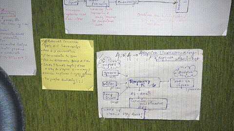

# AURA — Adaptive Understanding and Response Assistant

**A voice and camera assistant prototype for exploring speech-based access to objects and short printed information.**

[](https://www.python.org/)
[](LICENSE)

The prototype combines voice input with an optional camera request.

---

## Demo Video

<div style="text-align: center;">



[📺 Watch Full Demo on YouTube](https://youtu.be/sjE98X0MNao)

*A demonstration of AURA's voice-first and vision-assisted workflow in action.*

</div>

---

## Problem Statement

The project explores whether speech and optional camera input can help with short descriptions of objects and printed information. This repo does not contain user research or an accessibility evaluation.

---

## Proposed Solution

AURA is an experimental voice assistant with an optional camera path.

Users speak after activating the wakeword. Some requests cause a still image to be captured and sent to the vision provider.

The current code is a command-line prototype and has not been evaluated with older adults, blind or low-vision users, or people with limited literacy. It is not a validated accessibility product.

---

## Intended audience

The project was motivated by accessibility needs. It has not been tested with its intended audience and should not be treated as an accessibility aid.

---

## Intended Use Case

### Understanding Physical Objects and Written Information

AURA explores spoken descriptions of objects and short text.

**Example scenarios:**
- 💊 Identifying medicines or household objects
- 🏷️ Reading labels, notices, or short printed text
- 📸 Understanding what is placed in front of the user

This is an exploratory use case, not an evaluated outcome.

---

## System Overview

AURA attempts this interaction sequence:

1. 🎤 User activates AURA with the wakeword
2. 📝 Speech is captured and transcribed in real time
3. 🤖 The system determines whether visual context is required
4. 📷 If needed, an image is captured using a camera
5. 🗣️ The AI processes the input and responds via speech

The implementation currently processes one request at a time and waits for a new wakeword before the next turn.

---

## Key Features

- 🔊 Wakeword-based voice interaction
- ⚡ Real-time speech-to-text processing
- 👁️ Vision-assisted understanding when required
- 🗣️ Spoken responses optimized for clarity
- 🔄 One utterance per wakeword activation
- 🧩 Modular architecture for future expansion

---

## Prototype status and limits

This repository contains an experimental, hardware-dependent prototype. The full voice/camera workflow has not been verified on a clean machine as part of this repository review. It requires working microphone, camera, and speaker devices; service credentials; and a platform-specific Picovoice keyword model that is not included. Model answers can be wrong, including descriptions of objects, labels, or medicines. Do not rely on AURA for medication decisions, emergencies, diagnosis, or other safety-critical tasks.

The wakeword is processed locally by Porcupine. Speech is streamed to Deepgram for transcription; the transcript is sent to Groq for intent routing and text responses. If the request invokes the camera path, a captured image is sent to Groq for vision processing without a preview screen. Review each provider's current privacy and retention terms before use, and do not capture or submit another person's image or speech without their permission. Captured image files are held in the ignored `.runtime/` folder only while the vision request runs and are then deleted when the request completes or fails.

---

## Project Context

This project is developed as part of a **college project exhibition**, aligned with societal needs and assistive technology objectives.
It is designed with real-world constraints, accessibility, and usability in mind.

---

## Technical Architecture

### Core Components

- **Wake Word Engine**: Picovoice Porcupine for "Hey Aura" detection
- **Speech Recognition**: Deepgram Flux real-time API
- **Vision Processing**: OpenCV for image capture
- **AI Processing**: Groq LLM for text and vision understanding
- **Text-to-Speech**: Edge TTS for spoken responses

### Project Structure

```
AURA/
├── main.py                 # Entry point and session management
├── wakeword/               # Wake word detection
├── stt/                    # Speech-to-text processing
├── intent/                 # Intent routing and classification
├── tools/                  # Tool execution and vision capture
├── llm/                    # LLM provider integration
├── tts/                    # Text-to-speech generation
├── chimes/                 # Audio feedback system
├── config/                 # Configuration and environment
└── requirements.txt        # Python dependencies
```

---

## Getting Started

### Prerequisites

- Python 3.8+
- Camera device
- Microphone
- Speakers
- Internet connection

### Installation

1. Clone the repository:
   ```bash
   git clone <repository-url>
   cd AURA
   ```

2. Install dependencies:
   ```bash
   pip install -r requirements.txt
   ```

3. Copy `config/.env.example` to `config/.env` and add your own API keys:
   ```env
   DEEPGRAM_API_KEY=...
   PICOVOICE_ACCESS_KEY=...
   GROQ_API_KEY=...
   ```
   Keep `config/.env` private. It is ignored by Git.

4. Download the Porcupine keyword model for your platform from Picovoice and place it in `wakeword/` with the platform-specific filename expected by `wakeword/aura_wakeword.py` (`hey_aura_new.ppn` on macOS, `hello_aura_rpi.ppn` elsewhere). The model is not included in this repository.

5. Run the application:
   ```bash
   python main.py
   ```

---

## Platform and deployment

AURA depends on local microphone, camera, and speaker devices and vendor-specific audio/runtime packages. It is intended to be run locally. A static or serverless Vercel deployment cannot provide this device access and is not a suitable deployment target for the current app.

---

## Contributing

This project was developed as part of a college project exhibition. Contributions are welcome to help improve accessibility and expand functionality for our target users.

---

## License

This project is licensed under the MIT License - see the [LICENSE](LICENSE) file for details.

---

## Acknowledgments

- Developed with consideration for elderly and visually impaired individuals
- Focused on real-world accessibility challenges
- Designed with practical impact in mind
